<div align="center">

# ⚔️ RPG LIFE TRACKER — `THE SYSTEM // SYS.OS`

**Hệ điều hành Kỷ luật Cá nhân & Phát triển Bản thân phong cách 16-Bit 2D Pixel Art (Local-First · AI-Powered · Native Windows HUD)**

[](#2-triết-lý-thiết-kế-16-bit--khoa-học-hành-vi)
[](#4-kiến-trúc-hệ-thống--công-nghệ)
[](#4-kiến-trúc-hệ-thống--công-nghệ)
[-73499e?style=flat-square&labelColor=12101a)](#52-chạy--build-bản-desktop-exe-siêu-nhẹ-không-cần-visual-studio)
[](#32-đấu-trường-tập-trung-16-bit--âm-thanh-webaudio-2-kênh)

[**Tổng Quan**](#1-tổng-quan) · [**Bộ Ảnh Thực Tế**](#3-trải-nghiệm-trực-quan-các-phân-hệ) · [**Kiến Trúc**](#4-kiến-trúc-hệ-thống--công-nghệ) · [**Cài Đặt Nhanh**](#5-cài-đặt--khởi-chạy) · [**Phím Tắt & An Toàn Dữ Liệu**](#6-phím-tắt-toàn-cục--cơ-chế-an-toàn-dữ-liệu)

</div>

---

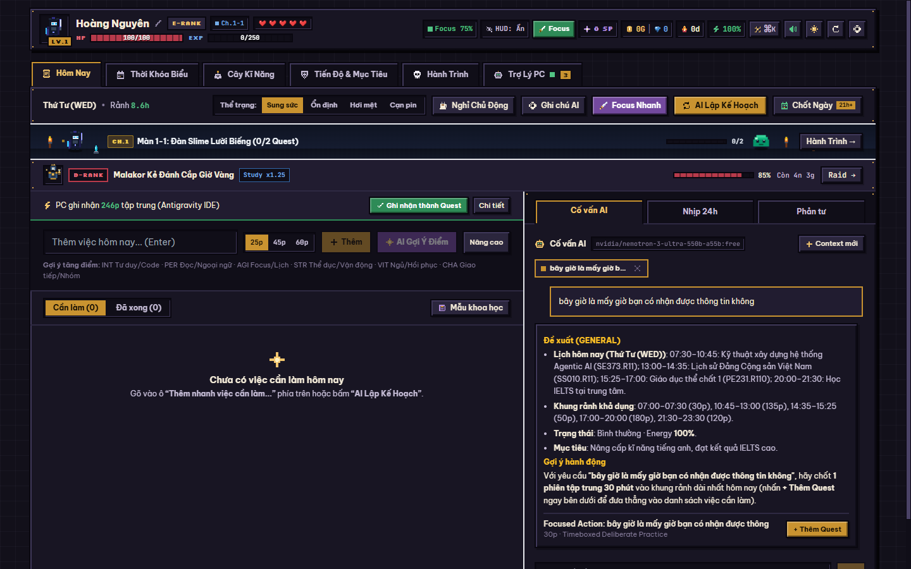

## 1. Tổng Quan

**RPG Life Tracker (`THE SYSTEM // SYS.OS`)** biến lịch trình học tập, làm việc sâu (*Deep Work*) và rèn luyện thói quen hằng ngày thành một thế giới nhập vai **16-Bit 2D Pixel Art** có luật lệ sinh tồn thật, kinh tế chặt chẽ và sự đồng hành của **AI Chiến Lược + Trợ Lý PC Bản Địa**.

Không chỉ là một danh sách việc cần làm đơn thuần, hệ thống kết nối khép kín cả ngày của bạn:
- **Buổi sáng & Trong ngày**: Phân tích khoảng trống trên **Thời Khóa Biểu**, dùng **AI Lập Kế Hoạch** chia việc vừa sức, bật **16-Bit Focus Arena** (kèm tiếng mưa/lửa trại tổng hợp WebAudio) và theo dõi nhịp độ qua **Floating Mini HUD** luôn nổi gọn trên góc màn hình Windows.
- **Tự động ghi nhận từ PC**: Tiến trình Rust Win32 / Trợ lý PC tự đo thời gian *Deep Work*, *Học tập* và *Xao nhãng* để quy đổi thành Quest và **tự động trừ máu Boss Đột Kích Tuần (Weekly Raid Boss)** theo thời gian thực.
- **Buổi tối (`21:00+`)**: Thực hiện **Nghi Thức Chốt Ngày Hardcore**, đối soát kỷ luật, dời việc tồn sang ngày mai và nhận phiếu **AI Chấm Điểm Hạng `S → D`** lưu vào hồ sơ dài hạn.

---

## 2. Triết Lý Thiết Kế 16-Bit & Khoa Học Hành Vi

| Trụ cột | Điểm khác biệt cốt lõi |
| :--- | :--- |
| **🎨 Thuần 16-Bit Pixel Art (Zero Neon)** | Không dùng hiệu ứng kính mờ (`backdrop-blur`), dải chuyển màu loè loẹt hay bo góc mềm. Toàn bộ ứng dụng dùng khung viền mực `#09070f`, đinh tán vàng 4 góc, thanh chỉ số phân đốt, cùng **48+ icon 16×16** và **sprite quái/boss 32×32** vẽ thủ công (`shape-rendering="crispEdges"`). |
| **🌗 2 Giao Diện Tương Phản Cao** | **Dark Mode (*Obsidian-Iron & Antique Gold*)** dịu mắt khi code/học đêm và **Light Mode (*Guild Tavern — Gỗ & Giấy Da Ấm*)** sắc nét như bảng ủy thác hội mạo hiểm giả. Cả hai tối ưu tiếng Việt dài hơi với `Silkscreen` + `Be Vietnam Pro` + `JetBrains Mono`. |
| **⚖️ Sinh Tồn Thật × Chống Kiệt Sức** | Bỏ lỡ nhiệm vụ trừ **HP thật** (về `0 HP` sẽ gục ngã và hồi sinh tại **Checkpoint**), hết Chủ nhật chưa hạ **Boss Tuần** chịu phạt `-25% HP & -10% Gold`. Song hành với đó là **Nghỉ Chủ Động (Grace Day)**, **10s Micro-Gap Neural Replay** (củng cố trí nhớ hồi hải mã `20x`) và **Calm Guard 2 tầng** không gây giật mình. |
| **🔒 100% Local-First & Offline-Ready** | Toàn bộ hồ sơ, lịch học, nhật ký PC và khóa API nằm gọn trong tệp `data/the_system.sqlite` (chế độ WAL + tự động xoay vòng bản sao lưu). Hỗ trợ mọi API tương thích OpenAI/OpenRouter/Ollama và **tự động chuyển sang bộ suy luận nội bộ 100%** khi ngoại tuyến. |

---

## 3. Trải Nghiệm Trực Quan Các Phân Hệ

### 3.1. Trung Tâm `Hôm Nay` — Giao Diện Tối (*Obsidian*) & Sáng (*Guild Tavern*)

Màn hình điều hành chính gom trọn trạng thái nhân vật (`LV`, `HP`, `EXP`, `SP`, `Gold`, `Runestones`), thanh tiến độ Hầm Ngục & Boss Tuần 1 dòng, cầu nối quy đổi giờ tập trung từ PC (*Focus Bridge*), khung thêm việc nhanh và bảng **Cố Vấn AI Đa Ngữ Cảnh**.

| Chế độ Tối (*Obsidian-Iron & Antique Gold*) | Chế độ Sáng (*Guild Tavern*) + Bộ Trộn Âm Thanh Nổi |
| :---: | :---: |
|  | 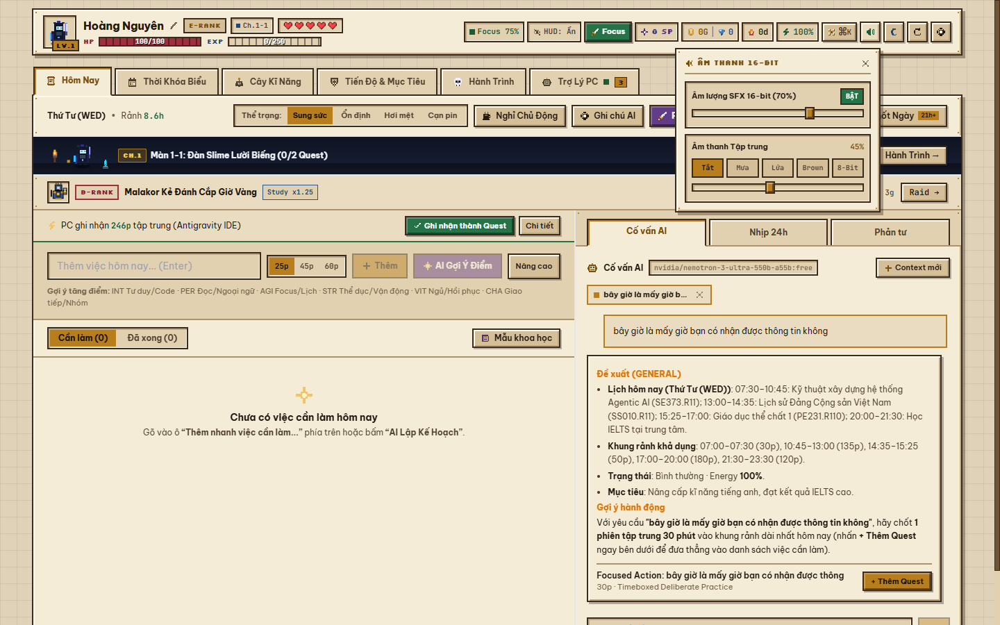 |

---

### 3.2. Đấu Trường Tập Trung 16-Bit & Âm Thanh WebAudio 2 Kênh

Bấm **`Focus`** trên thanh trên cùng hoặc **`Focus Nhanh`** (`25p / 45p / 60p / 90p`) để bước thẳng vào **16-Bit Dungeon Focus Arena** đồng bộ 2 chiều với SQLite và Mini HUD:
- **Chế độ `BATTLE` & `ZEN`**: Chuyển 1 chạm giữa sân khấu chiến đấu trực tiếp với Boss Tuần (có số sát thương bay, tích **Focus Combo `x0..x5`**) hoặc đồng hồ **Zen** tối giản tuyệt đối khi đọc tài liệu / luyện IELTS.
- **Overtime (`+Flow`) & Bắt Xao Nhãng PC**: Khi hết giờ mà bạn vẫn đang cuốn vào việc, đồng hồ tự đếm xuôi `+MM:SS FLOW` để cộng thêm **Bonus XP (tối đa `+40%`)** và sát thương Boss. Nếu chuyển sang ứng dụng giải trí quá 10 giây, Boss sẽ tung đòn phản công nhẹ làm đứt chuỗi Combo.
- **Âm thanh WebAudio thuần (`0 MB` tệp âm thanh ngoài)**: Tổng hợp trực tiếp 4 không gian nền (**Mưa Hầm Ngục**, **Lửa Trại**, **Brown Noise**, **8-Bit Chill Tavern**) độc lập với kênh hiệu ứng SFX 16-bit.

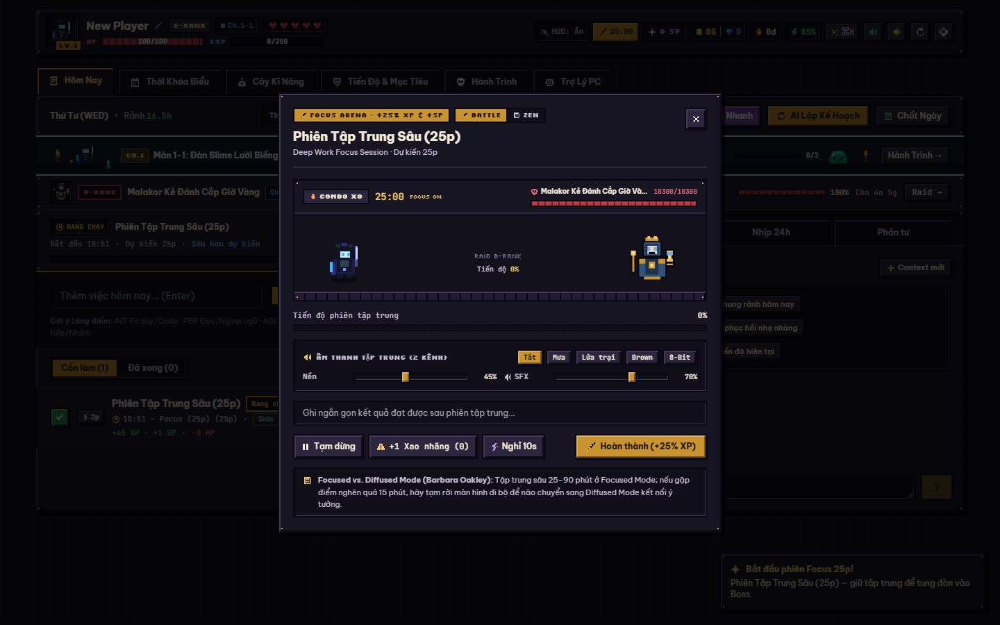

---

### 3.3. Boss Đột Kích Tuần (Weekly Raid Boss) & Hành Trình 8 Chương Fog-of-War

Mỗi sáng Thứ 2 (`00:00` → Chủ nhật `23:59` giờ VN), hệ thống triệu hồi một **Boss Đột Kích Tuần** mới (bằng **OpenRouter AI** hoặc bộ 8 chủng tộc Boss pixel nội bộ) với **Điểm Yếu `x1.25` sát thương** khớp trực tiếp mục tiêu cá nhân của bạn:
- **Tự động nhận sát thương thời gian thực** từ số phút *Deep Work / Học tập* trên PC, *Quest hoàn thành*, hệ số *Focus Score*, *Streak* và nhánh `+BOSS` của Cây Kĩ Năng.
- **Áp lực Kỷ luật Dark Regen**: Nếu tổng thời gian xao nhãng trong ngày chạm trần ngân sách (`45 phút`), Boss tự hồi lại `5%–8% HP` (tối đa 1 lần/ngày).
- **5 Rương Kho Báu & Hành Trình 8 Chương**: Mở rương tại các mốc `75%`, `50%`, `25%`, `0% HP` (rơi trang bị hiếm vào Kho 18 ô + mở khóa Danh hiệu tuần) và **Kho Báu Overkill** nếu hạ sớm. Phía dưới là chiến dịch 8 Chương *Fog-of-War* (`CH.1 → CH.8`) mở dần theo thực lực.

| Đấu Trường Boss Đột Kích Tuần (`B / A / S-Rank`) | 5 Rương Kho Báu, Dark Regen, Nhật Ký Đòn Đánh & 8 Chương |
| :---: | :---: |
| 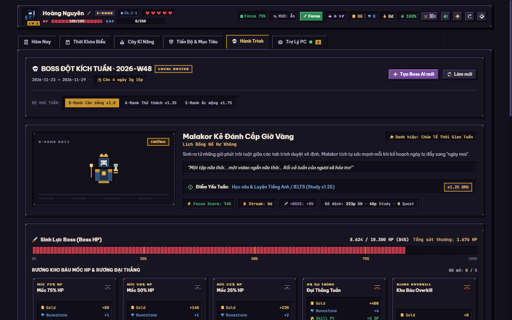 | 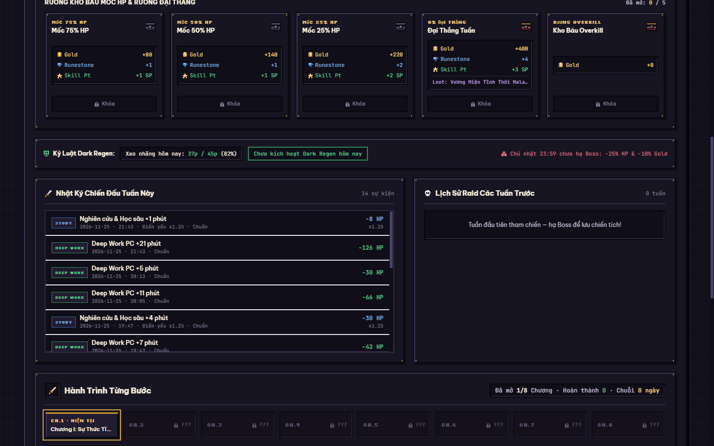 |

---

### 3.4. Nghi Thức Chốt Ngày Tối 16-Bit (`21:00+` Evening Closeout & AI Grading)

Từ `21:00` tối, nút **`Chốt Ngày`** bật tín hiệu vàng `21h+` nhắc bạn khép lại ngày làm việc một cách trung thực (thuần kỷ luật — không cộng điểm ảo):
- Đối soát toàn diện số phút Tập trung, Focus Score, Xao nhãng và sát thương Raid trong ngày.
- **Luật Hardcore RPG + Dời việc sang mai**: Các nhiệm vụ chưa hoàn thành chịu sát thương HP chuẩn sinh tồn, đồng thời cho phép tích chọn **`Dời sang mai`** để sao chép gọn sang lịch ngày hôm sau.
- **30 giây phản tư & Phiếu Chấm Điểm `S → D`**: Ghi nhận tâm trạng, điểm nghẽn và nhận phân tích 3 mũi nhọn (**Điểm Mạnh · Điểm Nghẽn · Chiến Thuật Ngày Mai**) lưu vĩnh viễn vào Nhật Ký SQLite.

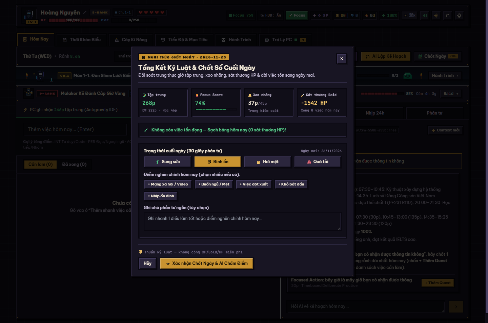

---

### 3.5. Cây Kĩ Năng Vô Hạn 5 Nhánh & Cửa Hàng Trang Bị Paperdoll

- **Cây Kĩ Năng Phát Triển Bản Thân (`5 Nhánh × 5 Tầng · 30 Nút`)**: Cơ chế mở khóa 2 cổng (*Dual-Gate*) — dùng **SP** mở nút & phá giới hạn (*Ascension ∞*), dùng **Gold / Runestones** nâng cấp bậc cộng thẳng chỉ số thụ động (`+XP`, `+GOLD`, `+MASTERY`, `+FOCUS`, `-FATIGUE`, `+BOSS`, `MAX HEARTS`). Mỗi nhiệm vụ hoàn thành tự động tích điểm rèn luyện vào nhánh tương ứng.
- **Trang Bị Nhân Vật & Kho 18 Ô**: Bảng *Paperdoll* 6 ô trang bị (`Mũ`, `Giáp`, `Vũ khí`, `Nhẫn`, `Cổ thư`, `Giày`), túi đồ lưới 18 ô cùng cửa hàng 36 cổ vật, linh dược hồi phục và phần thưởng tự thưởng ngoài đời thực.

| Cây Kĩ Năng 5 Nhánh × 5 Tầng (Phá Giới Hạn ∞) | Trang Bị Paperdoll 6 Ô, Kho 18 Ô & Cửa Hàng 36 Món |
| :---: | :---: |
| 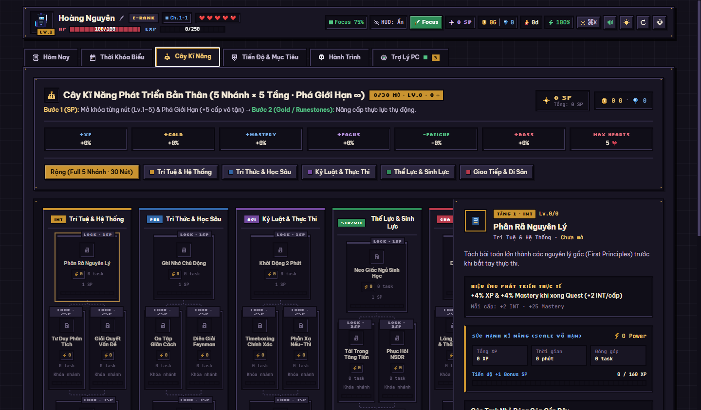 | 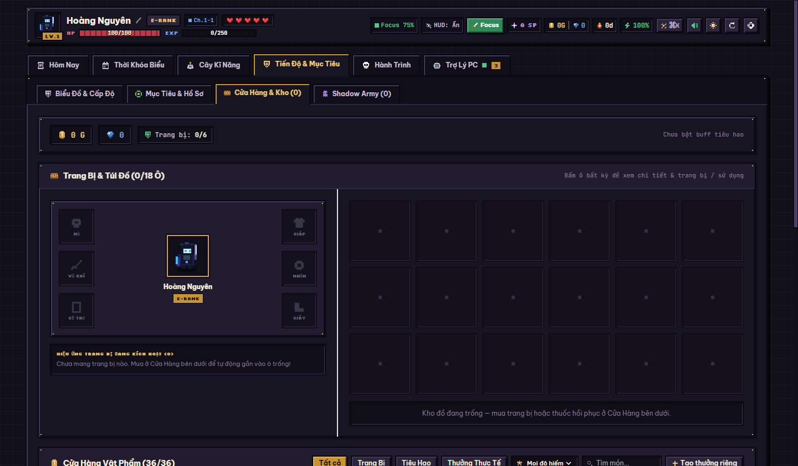 |

---

### 3.6. Thời Khóa Biểu Tuần, Biểu Đồ Cấp Độ & Hồ Sơ Tổng Kết 7/30 Ngày

- **Thời Khóa Biểu Tuần & AI Blueprint**: Nhập lịch học/làm việc từ tệp `.ics`, `.csv` hoặc văn bản tự nhiên; tự động đo lường các khoảng trống rảnh trong ngày và dùng **AI Lập Lịch Tuần (Blueprint)** xem trước trước khi áp dụng 1 chạm.
- **Phân Tích Hiệu Suất 7/30 Ngày**: Tự động phát hiện **Giờ Vàng Thực Tế** não bộ đạt độ tập trung sâu nhất từ log PC, vẽ **Bản Đồ Nhiệt Tập Trung 30 Ngày**, biểu đồ đối chiếu *Deep Work vs Xao nhãng*, chẩn đoán điểm nghẽn bằng AI và lưu trữ **Nhật Ký Chốt Ngày Gần Đây**.

| Thời Khóa Biểu Tuần & AI Blueprint | Hồ Sơ Hiệu Suất, Bản Đồ Nhiệt 30 Ngày & Giờ Vàng |
| :---: | :---: |
| 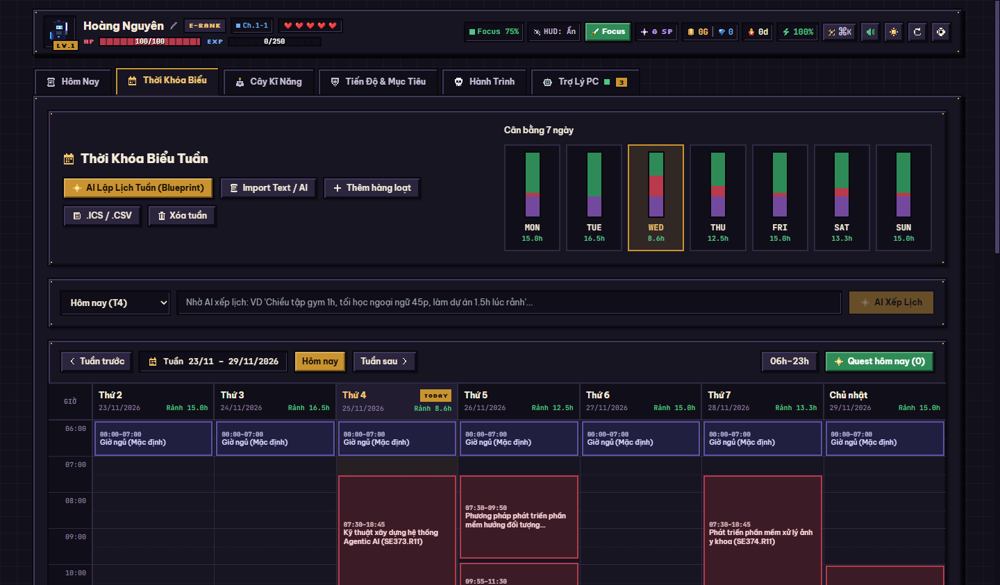 | 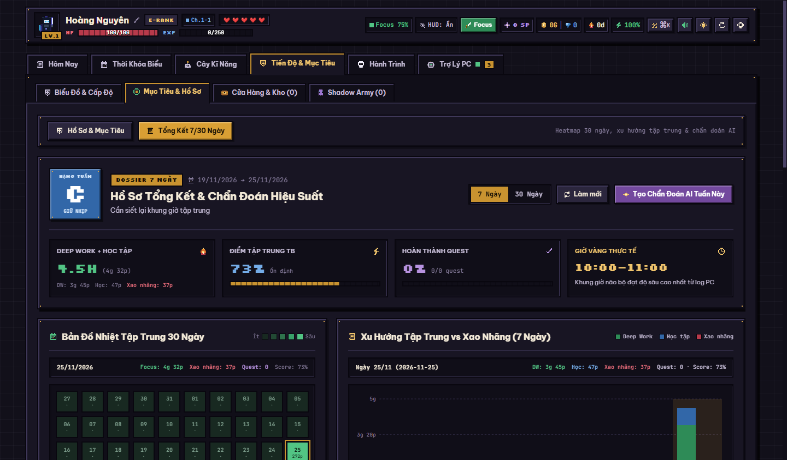 |

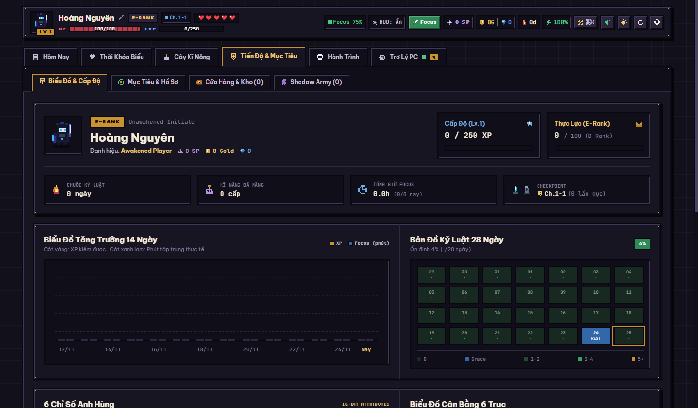

---

### 3.7. Trợ Lý PC Bản Địa, Floating Mini HUD (`~29MB RAM`) & Mobile Companion PWA

- **Trợ Lý PC & Tauri v2 Native Shell**: Theo dõi cửa sổ đang mở dưới nền Windows bằng Rust Win32 (`0` cửa sổ console ẩn), tự phân loại *Làm sâu / Học tập / Giao tiếp / Xao nhãng*, nhắc nghỉ *Calm Guard* 2 tầng, chế độ **Tạm im 1 giờ (DND)** và hỗ trợ tự khởi động cùng Windows.
- **2D Pixel Floating Mini HUD (`/#/hud`)**: Cửa sổ không viền trong suốt luôn nổi góc màn hình với 3 kích cỡ (`MINI 284×68`, `NORMAL`, `EXPANDED`), kéo thả tự nhớ vị trí đa màn hình, hiển thị trực tiếp đồng hồ đếm ngược khi đang Focus và điều khiển tức thì từ biểu tượng Khay Hệ Thống (*System Tray*).
- **Mobile Companion PWA (`/#/mobile`)**: Quét mã QR qua mạng LAN hoặc Tailscale (xác thực PIN/Token an toàn) để xem nhanh việc trong ngày, bấm hoàn thành Quest, cập nhật thể trạng hoặc bật DND ngay từ điện thoại.

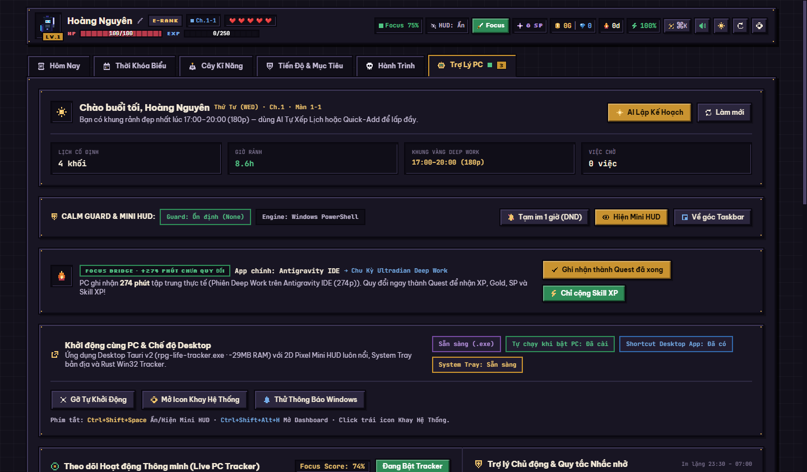

| Floating 2D Pixel Mini HUD (Góc Màn Hình Windows) | Ứng Dụng Đồng Hành Mobile PWA (Quét QR LAN / Tailscale) |
| :---: | :---: |
| 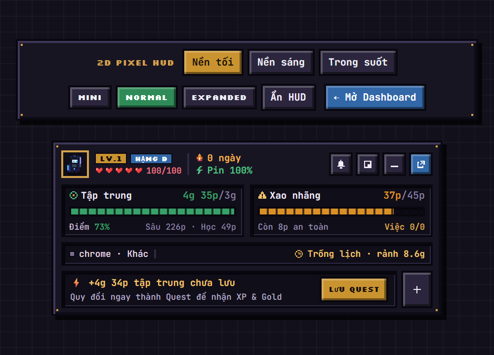 | 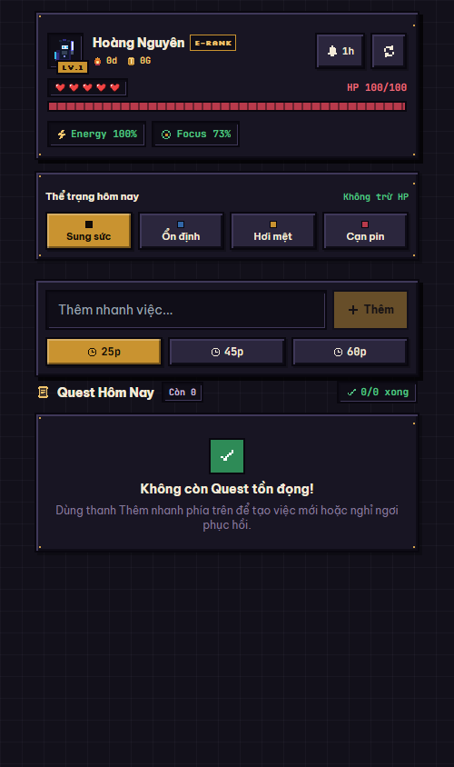 |

---

## 4. Kiến Trúc Hệ Thống & Công Nghệ

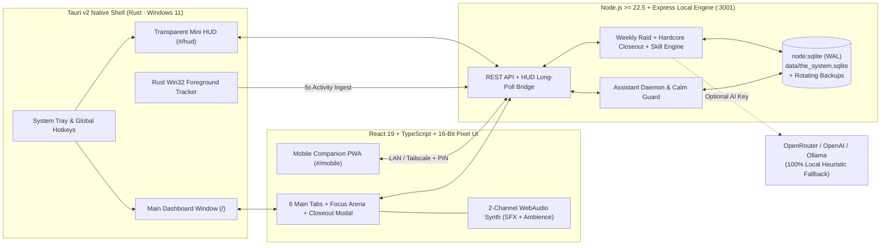

### Cấu Trúc Thư Mục Chính

```text
SoloLeveling/
├── src/                        # Giao diện React 19 + TypeScript (16-Bit 2D Pixel Art)
│   ├── components/
│   │   ├── PixelIcons.tsx            # Bộ 48+ icon pixel 16×16 crispEdges & đinh tán góc
│   │   ├── DungeonSprites.tsx        # Hero sprites, quái hầm ngục & cảnh chiến đấu
│   │   ├── RaidBossSprites.tsx       # 8 chủng tộc Boss Tuần 32×32 (Normal/Enraged/Defeated)
│   │   ├── TopSystemHud.tsx          # Thanh trạng thái Hunter, Focus nhanh & Popover Âm thanh
│   │   ├── QuestCouncilBoard.tsx     # Tab Hôm Nay, danh sách Quest & Cố vấn AI
│   │   ├── DungeonFocusModal.tsx     # Đấu trường Tập trung 16-Bit (Battle/Zen + Overtime)
│   │   ├── EveningCloseoutModal.tsx  # Nghi thức Chốt Ngày Hardcore & Phiếu điểm S–D
│   │   ├── WeeklyRaidBossArena.tsx   # Đấu trường Boss Đột Kích Tuần & 5 Rương thưởng
│   │   ├── BossAndSkillsView.tsx     # Hành trình 8 Chương Fog-of-War & Boss cá nhân
│   │   ├── SkillTreeView.tsx         # Cây kĩ năng vô hạn 5 nhánh × 5 tầng
│   │   ├── TimetablePlanner.tsx      # Thời khóa biểu tuần & AI Blueprint
│   │   ├── WeeklyReviewDossier.tsx   # Hồ sơ 7/30 ngày, Heatmap & Nhật ký Chốt Ngày
│   │   ├── ShopAndInventoryView.tsx  # Paperdoll 6 ô, Kho 18 ô & Cửa hàng 36 vật phẩm
│   │   ├── AssistantCenterView.tsx   # Trung tâm Trợ lý PC, Calm Guard & Focus Bridge
│   │   ├── FloatingHudPage.tsx       # Giao diện Mini HUD nổi trên màn hình (#/hud)
│   │   └── MobileQuickView.tsx       # Giao diện Mobile PWA (#/mobile)
│   ├── utils/
│   │   ├── soundEngine.ts            # Bộ tổng hợp WebAudio 2 kênh (SFX 16-bit + 4 Ambience)
│   │   └── api.ts                    # Typed REST API client (hỗ trợ Web & Tauri protocol)
│   └── index.css                     # Hệ thống thiết kế Obsidian-Iron (Dark) & Guild Tavern (Light)
├── server/                     # Backend Local-First (Express + node:sqlite WAL)
│   ├── index.ts                      # REST endpoints, cơ chế kinh tế RPG & HUD bridge
│   ├── db.ts                         # Schema SQLite, migrations an toàn & truy vấn giao dịch
│   ├── weekly-raid.ts                # Động cơ Boss Tuần, AI boss generator, Dark Regen & Chests
│   ├── evening-closeout.ts           # Động cơ Chốt Ngày, dời việc & chấm điểm S–D
│   ├── ai-orchestrator.ts            # Điều phối đa ngữ cảnh LLM + dự phòng ngoại tuyến
│   ├── ai-analytics.ts               # Phân tích 7/30 ngày, Giờ Vàng & AI Blueprint
│   ├── desktop-tracker.ts            # Phân loại cửa sổ PC & tính điểm Focus Score
│   ├── assistant-daemon.ts           # Nhắc lịch thông minh, Calm Guard & Windows Toast
│   └── backup-network.ts             # Sao lưu xoay vòng SQLite & xác thực QR LAN/Tailscale
├── src-tauri/                  # Ứng dụng Desktop Windows Bản Địa (Tauri v2 + Rust)
│   └── src/                          # Quản lý cửa sổ, System Tray, Single-Instance, Win32 Tracker
├── scripts/
│   └── build-tauri-light.ps1         # Script build .exe siêu nhẹ bằng Portable MSVC (không cần VS)
└── docs/screenshots/           # Bộ ảnh chụp giao diện thực tế
```

---

## 5. Cài Đặt & Khởi Chạy

> [!IMPORTANT]
> Yêu cầu **Node.js `>= 22.5.0`** (sử dụng mô-đun `node:sqlite` tích hợp sẵn tốc độ cao của Node 22, không cần biên dịch `better-sqlite3`).

### 5.1. Chạy Bản Web (Localhost + LAN Mobile PWA)

```powershell
# 1. Cài đặt thư viện
npm.cmd install

# 2. Chế độ phát triển (Vite HMR tại http://localhost:5173 + API tại http://localhost:3001)
npm.cmd run dev

# 3. Build & chạy bản Production ổn định tại http://localhost:3001
npm.cmd run build
npm.cmd start
```

### 5.2. Chạy & Build Bản Desktop `.exe` Siêu Nhẹ (Không Cần Visual Studio)

Dự án đi kèm bộ kịch bản **`scripts/build-tauri-light.ps1`** cho phép biên dịch tệp thực thi độc lập `src-tauri/target/release/rpg-life-tracker.exe` (`~4.2 MB`, chiếm `~29 MB RAM` khi chạy nền) chỉ với **Rust minimal + Portable MSVC (`D:\tools\msvc`)** mà không cần cài đặt bộ Visual Studio C++ nặng hàng chục GB:

```powershell
# Kiểm tra nhanh mã nguồn Rust + Tauri
npm.cmd run tauri:check

# Build trọn gói Frontend + nhúng vào file thực thi rpg-life-tracker.exe (Release)
npm.cmd run tauri:build

# Khởi chạy ngay ứng dụng Desktop bản địa (System Tray + Floating Mini HUD)
npm.cmd run tauri:launch
```

---

## 6. Phím Tắt Toàn Cục & Cơ Chế An Toàn Dữ Liệu

### Tổ Hợp Phím & Điều Khiển Nhanh

| Thao tác / Phím tắt | Tác dụng |
| :--- | :--- |
| **`Ctrl + Shift + Space`** | Ẩn / Hiện nhanh **2D Pixel Mini HUD** từ bất kỳ ứng dụng nào trên Windows |
| **`Ctrl + Shift + Alt + H`** | Mở nhanh cửa sổ **Dashboard Chính** lên tiền cảnh |
| **Click trái icon Khay Hệ Thống** | Bật / Tắt tức thì **Mini HUD** (Click đúp mở Dashboard, Click phải mở menu nhanh) |
| **`Ctrl + K`** (hoặc **`⌘K`**) | Mở bảng lệnh nhanh (**Command Palette**) chuyển tab & kích hoạt tác vụ trong 1 giây |
| **`Esc`** | Đóng nhanh các hộp thoại Modal hoặc Popover đang mở |

### Bảo Mật & Sao Lưu Dữ Liệu Cá Nhân

- **Lưu trữ hoàn toàn cục bộ**: Mọi dữ liệu nằm tại `data/the_system.sqlite` (đã được cấu hình loại trừ trong `.gitignore` để không bao giờ lộ lịch cá nhân hay API Key khi đẩy mã nguồn lên Git).
- **Sao lưu tự động xoay vòng (*Rotating Auto-Backups*)**: Hệ thống tự động tạo các bản sao lưu định kỳ trong `data/backups/`, hỗ trợ tải xuất/nhập JSON và tự chụp ảnh trạng thái an toàn trước mỗi lần khôi phục.
- **2 chế độ làm mới linh hoạt**: Trong phần **Cài Đặt Hệ Thống (⚙)**, bạn có thể chọn **Reset Tiến Độ RPG** (về `LV.1` nhưng giữ nguyên Hồ sơ cá nhân & Thời khóa biểu) hoặc **Reset Toàn Bộ** khi muốn khởi tạo lại từ đầu.
